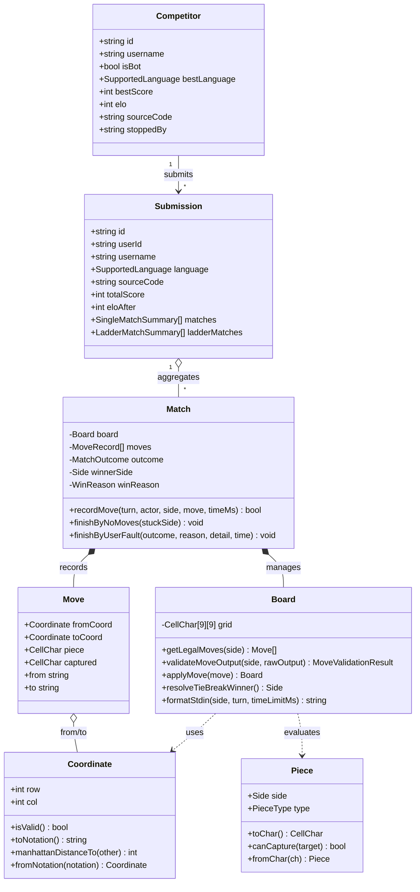
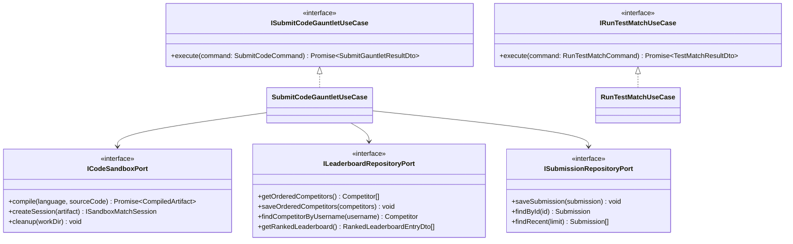
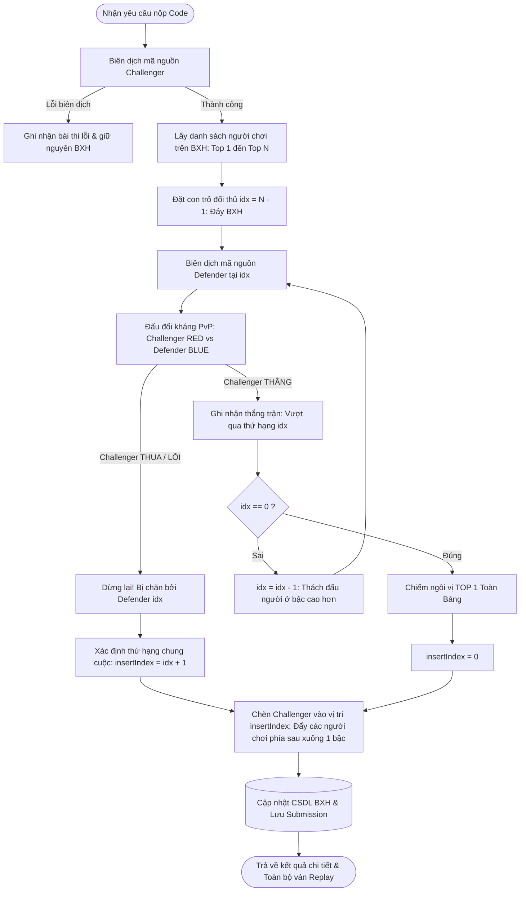
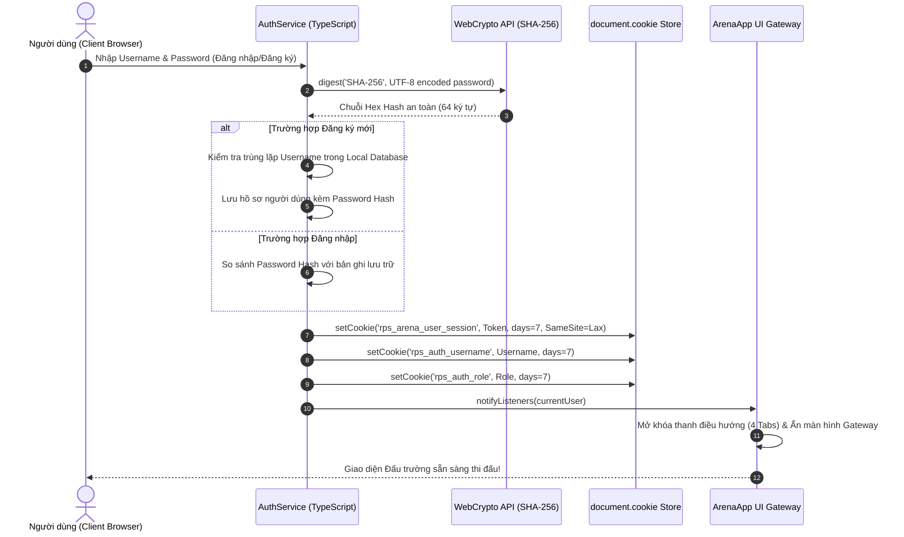
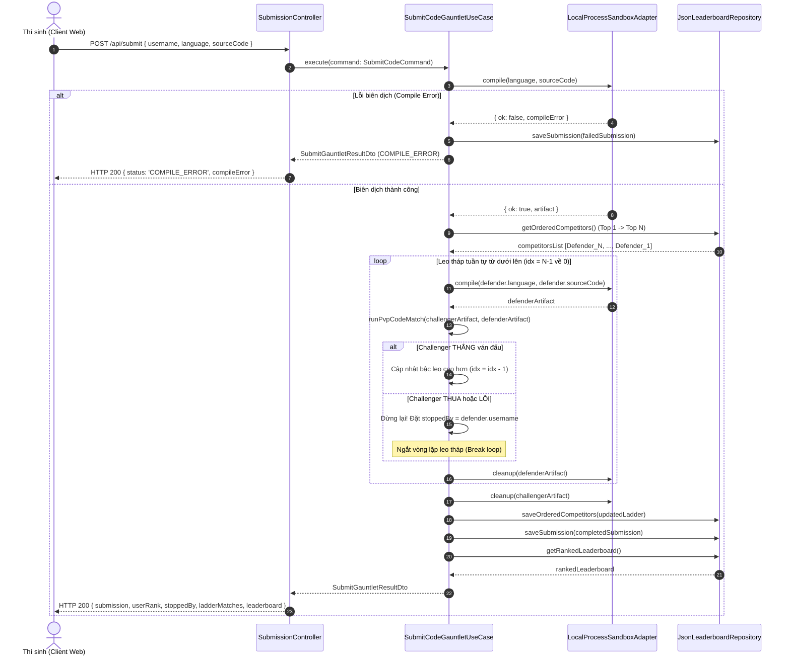
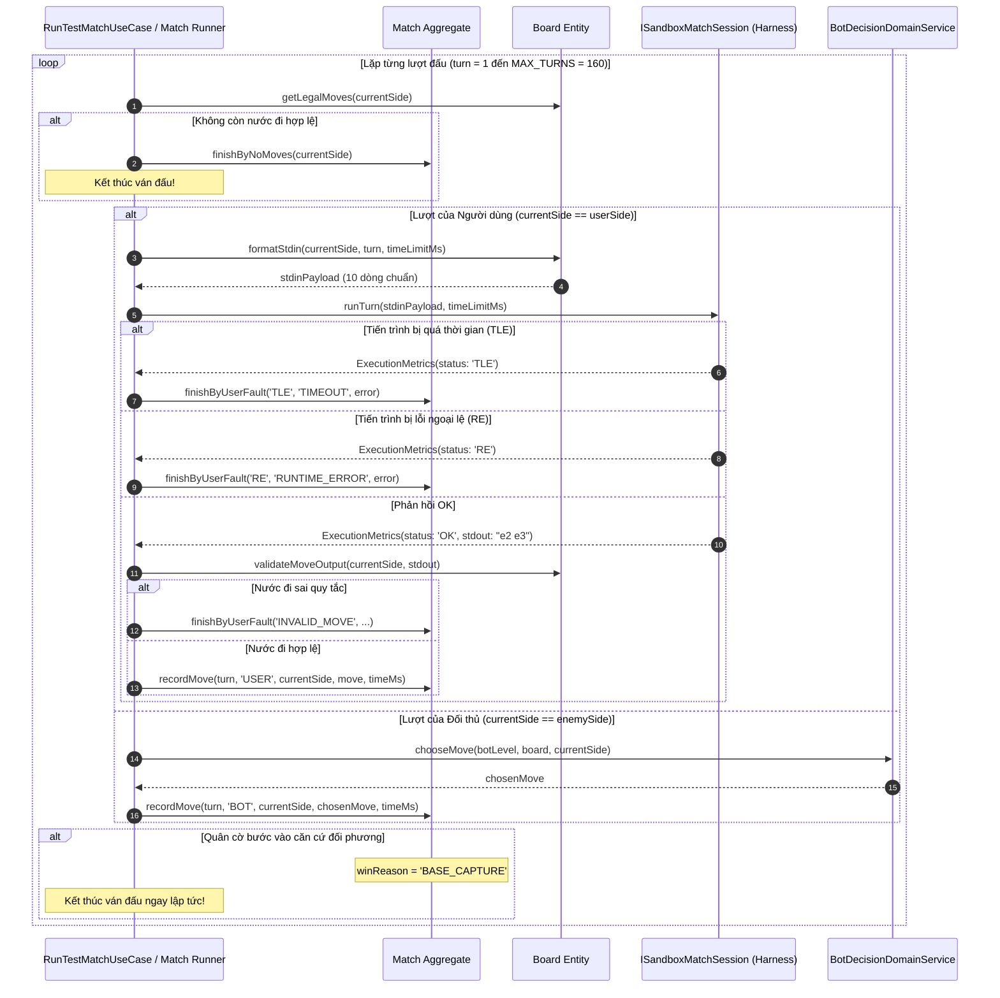

# TÀI LIỆU THIẾT KẾ KIẾN TRÚC & HỆ THỐNG CHI TIẾT (SYSTEM ARCHITECTURE & SOFTWARE DESIGN DOCUMENT)

**Dự án**: Đấu Trường Trí Tuệ Nhân Tạo Cờ Đấm - Lá - Kéo 9x9 (*MIT Battlecode RPS 9x9 AI Arena*)  
**Phiên bản**: 2.0.0 (Enterprise Architecture Edition)  
**Tiêu chuẩn kiến trúc**: Hexagonal Architecture (Ports & Adapters) kết hợp Domain-Driven Design (DDD)  
**Ngôn ngữ triển khai**: Pure TypeScript (Strict Mode) trên cả Backend (Node.js) và Frontend (Browser Hybrid Engine)  
**Thời gian ban hành**: Tháng 10/2026  

---

## 1. TỔNG QUAN HỆ THỐNG & ĐẶC TẢ YÊU CẦU (SYSTEM OVERVIEW & REQUIREMENTS SPECIFICATION)

### 1.1. Giới thiệu Dự án & Tuyên bố Bài toán (Problem Statement)
Hệ thống **RPS Chess 9x9 AI Arena** là nền tảng đấu trường học thuật mô phỏng đối kháng thông minh, cho phép người dùng nghiên cứu, phát triển và nộp các thuật toán Trí tuệ Nhân tạo (AI Bot) viết bằng đa ngôn ngữ (**JavaScript, Python 3, C++17, Java 17/21**). Các Bot được đưa vào môi trường thực thi cô lập (Sandbox), tự động đọc dữ liệu trận đấu và đưa ra quyết định di chuyển chiến thuật trên bàn cờ **9x9 Đấm - Lá - Kéo** nhằm đánh bại 4 cấp độ Bot chuẩn mực hoặc đối đầu với những người chơi khác trên Bảng xếp hạng.

Hệ thống giải quyết các thách thức kỹ thuật cốt lõi:
1. **Cô lập thực thi an toàn (Safe Execution & Sandboxing)**: Chạy mã nguồn tùy ý của người dùng mà không gây nguy hiểm cho máy chủ, kiểm soát chặt chẽ giới hạn thời gian (Time Limit Exceeded - TLE), bộ nhớ và lỗi ngoại lệ (Runtime Error - RE).
2. **Triệt tiêu độ trễ khởi động Runtime (Zero-overhead IPC Harnessing)**: Xử lý bài toán thắt nút cổ chai (bottleneck) khi gọi trình thông dịch Python hoặc máy ảo JVM liên tục qua từng lượt đi, giảm thiểu thời gian phản hồi từ hàng trăm mili-giây xuống mức dưới 2 mili-giây mỗi lượt.
3. **Kiến trúc phân tầng chặt chẽ (Clean/Hexagonal Architecture)**: Tách biệt hoàn toàn logic nghiệp vụ cốt lõi (Domain rules) khỏi hạ tầng giao tiếp (HTTP, CLI, File Storage, Docker, Process Subsystem).
4. **Vận hành linh hoạt kép (Dual-Engine Capability)**: Hỗ trợ cả mô hình Full-Stack Server-Client (qua REST API và Persistent Process/Docker Sandbox) lẫn mô hình Standalone Serverless 100% Client-Side Engine (triển khai tĩnh trên GitHub Pages, đồng bộ trạng thái phân tán qua WebRTC/Edge sync).

---

### 1.2. Mục tiêu Kiến trúc (Architectural Goals)
* **Maintainability & Extensibility**: Áp dụng triệt để kiến trúc Hexagonal (Ports & Adapters) kết hợp Domain-Driven Design (DDD). Logic bàn cờ và giải thuật hoàn toàn độc lập với Framework bên ngoài (Zero-dependency Domain).
* **Security & Isolation**: Mã nguồn người dùng được cô lập ở mức tiến trình con (Process-level sandboxing) hoặc vùng chứa (Container-level sandboxing) với các ràng buộc tài nguyên nghiêm ngặt.
* **Low Latency & High Throughput**: Áp dụng mô hình **Persistent Harness Pattern** nhằm tái sử dụng tiến trình thực thi của Python/Java qua dòng dữ liệu IPC (Inter-Process Communication), ngăn chặn việc khởi tạo Runtime lặp lại qua từng lượt đi.
* **Resilience & Fault Tolerance**: Xử lý rành mạch mọi trường hợp lỗi từ Bot: Timeout, Stack Overflow, Out of Memory, Invalid Move Format, Violating Capture Rules mà không gây gián đoạn hệ thống.

---

### 1.3. Đặc tả Yêu cầu Chức năng (Functional Requirements - FR)

| Mã Yêu Cầu | Tên Phân Hệ | Mô Tả Nghiệp Vụ Chi Tiết |
| :--- | :--- | :--- |
| **FR-01** | **Xác thực & Phiên làm việc (Auth & Session)** | Cung cấp cơ chế Đăng ký / Đăng nhập tài khoản với phân quyền RBAC (`USER`, `ADMIN`). Quản lý phiên làm việc thông qua Cookie trình duyệt (`document.cookie`), hỗ trợ lưu trữ dài hạn (7 ngày), tự động phục hồi phiên, và bảo vệ mật khẩu bằng hàm băm mật mã học (WebCrypto SHA-256). |
| **FR-02** | **Đấu Tập Tay (Sandbox Practice)** | Cung cấp bàn cờ tương tác trực tiếp 9x9 với đồ họa trực quan. Người dùng cầm quân Đỏ thi đấu theo thời gian thực với 1 trong 4 Bot AI chạy trực tiếp tại Client. Bàn cờ hiển thị gợi ý ô di chuyển hợp lệ, ô ăn quân và thông tin chỉ số quân cờ (Unit Inspector HUD). |
| **FR-03** | **Phòng Lab Code (Bot Studio IDE)** | Môi trường tích hợp soạn thảo mã nguồn đa ngôn ngữ (JavaScript, Python 3, C++17, Java). Cung cấp mã nguồn khởi tạo mẫu (Starter Templates) chuẩn mực, tính năng phục hồi mã gốc, và kiểm thử nhanh với 4 cấp độ Bot trong thời gian < 0.05 giây. |
| **FR-04** | **Trình Đánh Giá & Biên Dịch (Code Evaluation)** | Tiếp nhận mã nguồn, tự động định tuyến trình biên dịch (G++17, Javac, Python syntax checker), kiểm tra cú pháp và khởi tạo môi trường thực thi cô lập. |
| **FR-05** | **Giải Đấu Leo Tháp (Bottom-Up Ladder Tournament)** | Cơ chế thi đấu leo tháp xếp hạng tự động: Khi người chơi nộp mã nguồn, hệ thống cho Bot của người chơi thách đấu tuần tự từ người giữ vị trí thấp nhất trên BXH (#N) ngược lên vị trí cao nhất (#1). Thắng thì leo tiếp lên bậc trên; dừng lại tại bậc nào thì chèn vào ngay dưới đối thủ đó và cập nhật bảng xếp hạng. |
| **FR-06** | **Đấu Trường Cướp Cờ (King-of-the-Hill CTF)** | Chế độ thi đấu chiếm giữ Ngôi Vương thời gian thực. Người giữ cờ tối thượng (The King) công khai mã nguồn phòng thủ. Thí sinh đọc mã nguồn đối thủ, xây dựng chiến thuật khắc chế (Counter-strategy) và thách đấu trực diện để đoạt cờ. Đồng bộ trạng thái phòng đấu tức thời qua giao thức P2P/Edge (`playhtml`). |
| **FR-07** | **Trình Trực Quan Hóa Trận Đấu (Replay & Telemetry)** | Ghi lại toàn bộ diễn biến ván cờ theo từng Frame. Cho phép tua tới/lui (Scrubber), phát tự động, chỉnh tốc độ (0.5x, 1x, 2x, 4x), phím tắt bàn phím (Space, Arrow keys, Home, End), hiển thị đồ thị tương quan lực lượng hai phe qua các lượt đi (Match Telemetry) và trích xuất file chuẩn JSON. |
| **FR-08** | **Bảng Quản Trị Hệ Thống (Admin Control Console)** | Cho phép người dùng có quyền `ADMIN` tùy chỉnh trực tiếp các thông số giải đấu: Giới hạn số lượt tối đa (`MAX_TURNS`), thời gian Timeout mỗi lượt (`TIMEOUT_MS`), và điều kiện chiến thắng ưu tiên. |

---

### 1.4. Đặc tả Yêu cầu Phi Chức Năng (Non-Functional Requirements - NFR)

1. **Hiệu năng & Thời gian thực thi (Performance & Latency)**:
   * Thuật toán kiểm tra tính hợp lệ của nước đi (Legal Move Generator): Phức tạp thời gian $O(K)$, với $K \le 9 \times 4 = 36$ phép toán, hoàn thành trong $< 0.1 \text{ ms}$.
   * Tối ưu hóa Persistent Process: Tái sử dụng tiến trình qua IPC Pipes, thời gian trễ trao đổi qua `stdin`/`stdout` đạt $\le 2 \text{ ms}$ cho Python và Java.
   * Giao diện Client mượt mà ở mức 60 FPS trong suốt quá trình phát lại Replay.
2. **Tính bảo mật (Security & Isolation)**:
   * Mã người dùng không được phép truy cập mạng (`--network=none`), không được cấp quyền root, giới hạn bộ nhớ $\le 256 \text{ MB}$, CPU $\le 1.0$ core, giới hạn số tiến trình con (`pids-limit = 32`).
   * Kiểm soát chặt chẽ Cookie: Thiết lập đầy đủ các cờ `SameSite=Lax`, `path=/`, giới hạn thời gian hết hạn rõ ràng, tự động kích hoạt `Secure` khi chạy trên giao thức HTTPS.
3. **Tính tương thích & Di động (Portability & Cross-Platform)**:
   * Tương thích tuyệt đối trên cả môi trường Windows, Linux và macOS.
   * Hỗ trợ triển khai tĩnh không cần Backend (Zero-backend static bundle) trên GitHub Pages thông qua ESBuild bundling.
4. **Tính nhất quán dữ liệu (Data Consistency)**:
   * Lưu trữ cục bộ đảm bảo nguyên tử hóa (Atomic write), chống xung đột dữ liệu (Race Conditions) khi nhiều lượt nộp bài diễn ra cùng lúc trên Server.

---

## 2. KIẾN TRÚC HỆ THỐNG TỔNG THỂ (OVERALL SYSTEM ARCHITECTURE)

Hệ thống được xây dựng dựa trên nguyên lý cốt lõi của **Hexagonal Architecture (Kiến trúc Lục giác - Ports and Adapters)** do Alistair Cockburn khởi xướng, kết hợp với phương pháp luận **Domain-Driven Design (DDD)** của Eric Evans.

```
+-----------------------------------------------------------------------------------+
|                           DRIVING / PRIMARY ADAPTERS                              |
|   +--------------------------+  +-------------------+  +----------------------+   |
|   |  Inbound HTTP Routes     |  | Inbound CLI Tool  |  | Client Browser Views |   |
|   | (Express Controllers)    |  | (ArenaCliRunner)  |  | (BoardView, Editor)  |   |
+---+--------------------------+--+-------------------+--+----------------------+---+
|                                      | calls                                      |
|                                      v                                            |
|   +---------------------------------------------------------------------------+   |
|   |                 APPLICATION CORE (PORTS & USE CASES)                      |   |
|   |  - Inbound Ports : ISubmitCodeGauntletUseCase, IRunTestMatchUseCase,      |   |
|   |                    IPlayManualMoveUseCase, IGetLeaderboardQuery           |   |
|   |  - Use Cases     : SubmitCodeGauntletUseCase, RunTestMatchUseCase,        |   |
|   |                    PlayManualMoveUseCase, GetLeaderboardService           |   |
|   |  - DTOs          : SubmitCodeDto, MatchResultDto, LeaderboardEntryDto     |   |
|   +---------------------------------------------------------------------------+   |
|            | calls (Outbound Ports)                   ^                           |
|            v                                          | encapsulates              |
|   +---------------------------------------------------+-----------------------+   |
|   |                     DOMAIN LAYER (ENTITIES & PURE LOGIC)                  |   |
|   |  - Aggregates    : Match, Submission                                      |   |
|   |  - Entities      : Board, Competitor                                      |   |
|   |  - Value Objects : Coordinate, Piece, Move, ExecutionMetrics              |   |
|   |  - Services      : BotDecisionDomainService, ScoringPolicy                |   |
|   +---------------------------------------------------------------------------+   |
|            | implemented by                                                       |
|            v                                                                      |
+-----------------------------------------------------------------------------------+
|                           DRIVEN / SECONDARY ADAPTERS                             |
|   +----------------------------------+  +-------------------------------------+   |
|   |       Outbound Sandboxes         |  |        Outbound Persistence         |   |
|   |  - LocalProcessSandboxAdapter    |  |  - JsonLeaderboardRepository        |   |
|   |  - DockerSandboxAdapter          |  |  - PostgresRepository               |   |
+---+----------------------------------+--+-------------------------------------+---+
```

### 2.1. Phân Rã Các Tầng Kiến Trúc (Architectural Layers)

#### Tầng 1: Domain Core (Trọng Tâm Miền Nghiệp Vụ)
* **Nguyên tắc thiết kế**: Pure TypeScript, tuyệt đối không phụ thuộc vào bất kỳ thư viện ngoài (Third-party packages) hay thành phần hạ tầng (I/O, Frameworks, Web APIs).
* **Nhiệm vụ**: Đóng gói các quy tắc kinh doanh bất biến (Invariants) của cờ Đấm - Lá - Kéo 9x9, định nghĩa các thực thể đại diện ván cờ (`Match`), bàn cờ (`Board`), bài thi đấu (`Submission`), đấu thủ (`Competitor`) và các giá trị bất biến (`Coordinate`, `Piece`, `Move`).

#### Tầng 2: Application Layer (Tầng Điều Phối Ứng Dụng)
* **Nguyên tắc thiết kế**: Định nghĩa các Use Case cụ thể của ứng dụng, triển khai nguyên lý Đảo ngược phụ thuộc (Dependency Inversion Principle - DIP).
* **Thành phần**:
  * **Inbound Ports (Driving Ports)**: Các Interface trừu tượng quy định chức năng đầu vào (`ISubmitCodeGauntletUseCase`, `IRunTestMatchUseCase`, v.v.).
  * **Outbound Ports (Driven Ports / SPI)**: Các Interface trừu tượng quy định dịch vụ hạ tầng cần sử dụng (`ICodeSandboxPort`, `ILeaderboardRepositoryPort`, `ISubmissionRepositoryPort`).
  * **Use Cases (Services)**: Thực thi logic điều phối, nhận DTO, tương tác với Domain và gọi Outbound Ports.

#### Tầng 3: Adapters Layer (Tầng Tiếp Hợp Hạ Tầng & Ngoại Vi)
* **Primary / Driving Adapters (Tiếp hợp đầu vào)**: Tiếp nhận các tác động từ thế giới bên ngoài vào ứng dụng:
  * `http/controllers`: Bộ điều khiển tiếp nhận HTTP Request từ trình duyệt, ánh xạ JSON Body thành Command/Query DTO.
  * `cli/ArenaCliRunner`: Điểm tiếp nhận lệnh qua giao diện dòng lệnh (Command Line Interface), phục vụ kiểm thử và xác minh luồng dữ liệu tự động.
* **Secondary / Driven Adapters (Tiếp hợp đầu ra)**: Cung cấp cài đặt cụ thể cho các Outbound Ports:
  * `sandbox/LocalProcessSandboxAdapter`: Quản lý việc biên dịch và spawn tiến trình cục bộ trên hệ điều hành.
  * `sandbox/DockerSandboxAdapter`: Quản lý việc thực thi mã nguồn bên trong Linux Container cô lập.
  * `persistence/JsonLeaderboardRepository`: Lưu trữ dữ liệu giải đấu vào hệ thống tệp JSON có đồng bộ giao dịch.
  * `persistence/PostgresRepository`: Cài đặt sẵn sàng cho việc kết nối hệ quản trị CSDL quan hệ PostgreSQL.

#### Tầng 4: Composition Root (Bộ Khởi Tạo & Tiêm Phụ Thuộc - Dependency Injection)
* Được đặt tại `server/src/main.ts`. Tại đây, toàn bộ các Domain Services, Repositories, Sandboxes, Use Cases và Controllers được khởi tạo và kết nối (wire) lại với nhau một cách minh bạch mà không cần tới các DI Framework nặng nề.

---

## 3. MÔ HÌNH HÓA MIỀN NGHIỆP VỤ (DOMAIN-DRIVEN DESIGN MODELING)



### 3.1. Các Thực Thể & Aggregate Roots

#### 1. `Match` (Aggregate Root quản lý trận đấu)
* **Ý nghĩa**: Đóng gói toàn bộ vòng đời của một ván cờ đối kháng 1-1 giữa người dùng và Bot, hoặc giữa hai Bot với nhau.
* **Quy tắc bảo toàn (Invariants)**:
  * Trạng thái bàn cờ (`Board`) chỉ được biến đổi thông qua hàm `recordMove()`.
  * Khi phát hiện quân cờ bước vào căn cứ đối phương (`isEnemyBase`), trận đấu lập tức phân định thắng thua và niêm phong trạng thái, không cho phép tiếp tục ghi nhận nước đi.
  * Theo dõi tổng thời gian thực thi của người chơi (`userExecTimeMs`) và số lượt hợp lệ (`userTurns`).

#### 2. `Board` (Thực thể mô hình hóa bàn cờ 9x9)
* **Đặc tính kỹ thuật**: Ma trận 2 chiều kích thước $9 \times 9$, lưu trữ các ký tự đại diện cho quân cờ:
  * Ký tự in hoa đại diện cho **Phe Đỏ (RED)**: `'R'` (Đấm), `'P'` (Lá), `'S'` (Kéo).
  * Ký tự in thường đại diện cho **Phe Xanh (BLUE)**: `'r'` (Đấm), `'p'` (Lá), `'s'` (Kéo).
  * Ký tự `'.'` biểu thị ô trống.
* **Quy tắc sinh nước đi (`getLegalMoves`)**:
  * Mỗi quân cờ chỉ được phép di chuyển đúng 1 ô theo 4 hướng trực giao (Lên, Xuống, Trái, Phải - khoảng cách Manhattan = 1).
  * Quân cờ **không bao giờ** được bước vào ô Căn cứ của chính phe mình (`a1` đối với Đỏ, `i9` đối với Xanh).
  * Ô đích phải là ô trống `'.'` hoặc chứa quân của đối phương mà quân mình có thể ăn được theo quy tắc khắc chế.

#### 3. `Submission` (Aggregate Root bài nộp giải thuật)
* Đại diện cho một lần nộp mã nguồn của thí sinh vào đấu trường. Chứa thông tin mã nguồn, trạng thái biên dịch (`COMPLETED` hoặc `COMPILE_ERROR`), danh sách toàn bộ các ván đấu con (`SingleMatchSummary` hoặc `LadderMatchSummary`), tổng điểm đạt được và thứ hạng chung cuộc.

#### 4. `Competitor` (Thực thể thí sinh / Đấu thủ giữ hạng)
* Biểu diễn một thí sinh hoặc một Bot cố định trên Bảng xếp hạng. Đóng gói mã nguồn tốt nhất (`sourceCode`), điểm số cao nhất (`bestScore`), chỉ số kỹ năng (`elo`), số trận thắng và tên đối thủ đã chặn đứng bước tiến (`stoppedBy`).

---

### 3.2. Các Đối Tượng Giá Trị (Value Objects)

* **`Coordinate`**: Đối tượng bất biến biểu diễn vị trí trên bàn cờ.
  * Hỗ trợ chuyển đổi 2 chiều giữa tọa độ đại số cờ chuẩn (ví dụ: `a1`, `e5`, `i9`) và chỉ số hàng cột ma trận:
    $$\text{col} = \text{fileIndex}('a' \dots 'i'), \quad \text{row} = 9 - \text{rank}$$
  * Tính toán khoảng cách Manhattan giữa 2 điểm:
    $$D_{\text{Manhattan}}(C_1, C_2) = |C_1.\text{row} - C_2.\text{row}| + |C_1.\text{col} - C_2.\text{col}|$$
* **`Piece`**: Đối tượng bất biến biểu diễn quân cờ và luật ăn quân.
  * Quy tắc khắc chế tuần hoàn:
    $$\text{Đấm } (R) \succ \text{Kéo } (S) \succ \text{Lá } (P) \succ \text{Đấm } (R)$$
* **`Move`**: Biểu diễn một bước di chuyển hợp lệ từ ô `fromCoord` đến `toCoord`, ghi nhận quân cờ di chuyển và quân cờ đối phương bị loại bỏ (`captured`).
* **`ExecutionMetrics`**: Đóng gói kết quả vi phân sau mỗi lượt chạy của tiến trình Bot: Mã trạng thái (`OK`, `TLE`, `RE`), nội dung xuất qua stdout, thời gian thực thi (tính bằng mili-giây) và thông điệp lỗi (nếu có).

---

### 3.3. Dịch Vụ Miền (Domain Services)

#### 1. `BotDecisionDomainService` (Trí tuệ Nhân tạo 4 Cấp Độ)
Dịch vụ cung cấp 4 chiến thuật AI chuẩn mực phục vụ kiểm thử và xếp hạng:
* **Cấp độ 1: Bot Tập Sự (Rookie - Elo 800)**:
  * Thuật toán: Tìm kiếm ngẫu nhiên có định hướng (Random Biased Walk). Ưu tiên các nước đi rút ngắn khoảng cách Manhattan tới căn cứ đối phương kèm hệ số nhiễu ngẫu nhiên.
* **Cấp độ 2: Bot Trinh Sát (Scout - Elo 1100)**:
  * Thuật toán: Chiến lược tham lam (Greedy Heuristic). Tính điểm ưu tiên: Ăn quân đối phương (+60 điểm), di chuyển an toàn không bị thiên địch ăn lại ở lượt kế tiếp (+35 điểm), thu hẹp khoảng cách tới căn cứ (+15 điểm/bước).
* **Cấp độ 3: Bot Chiến Thuật (Tactician - Elo 1450)**:
  * Thuật toán: Tìm kiếm đối kháng **Minimax kết hợp Cắt tỉa Alpha-Beta** ở độ sâu $d = 3$.
  * Hàm lượng giá (Evaluation Function):
    $$E(s) = 1000 \cdot (\Delta \text{Material}) + 40 \cdot (\Delta \text{Proximity}) + 20 \cdot (\text{Mobility}) - 80 \cdot (\text{Threats})$$
* **Cấp độ 4: Bot Đại Sư (Grandmaster - Elo 1800)**:
  * Thuật toán: **Alpha-Beta Search** độ sâu $d = 4$ kết hợp bản đồ nhiệt đe dọa (Threat Map) và cơ chế phòng thủ căn cứ chủ động. Nhận diện việc tạo gọng kìm săn mồi theo hệ sinh khắc của cờ Đấm - Lá - Kéo.

#### 2. `ScoringPolicy` (Chính Sách Tính Điểm & Xếp Hạng Elo)
* **Tính điểm tốc độ ván đấu**:
  $$\text{Score} = \begin{cases} 
  \text{BasePoints} + \left\lfloor \max(0, 160 - \text{Turns}) \times 0.5 \right\rfloor & \text{khi Thắng (WIN)} \\
  \left\lfloor \text{BasePoints} \times 0.25 \right\rfloor & \text{khi Hòa (DRAW)} \\
  0 & \text{khi Thua (LOSS)}
  \end{cases}$$
* **Hệ thống tính điểm kỹ năng Elo**:
  $$R_{\text{new}} = R_{\text{old}} + K \cdot (S - E)$$
  Trong đó: $K = 32$, $S \in \{1.0, 0.5, 0.0\}$ là kết quả thực tế, và $E$ là kỳ vọng chiến thắng:
  $$E = \frac{1}{1 + 10^{(R_{\text{bot}} - R_{\text{old}}) / 400}}$$
* **Chính sách Tie-Breaker khi chạm mốc 160 lượt**:
  1. Phe có số lượng quân cờ trên bàn nhiều hơn sẽ giành chiến thắng.
  2. Nếu số quân bằng nhau, phe nào sở hữu một quân cờ ở khoảng cách Manhattan gần căn cứ đối phương nhất sẽ thắng.
  3. Nếu vẫn bằng nhau tuyệt đối, phe phòng thủ (Defender - cờ Xanh) được tuyên bố chiến thắng theo luật bảo vệ thứ hạng.

---

## 4. THIẾT KẾ CHI TIẾT TẦNG APPLICATION & USE CASES

### 4.1. Đặc Tả Inbound & Outbound Ports



---

### 4.2. Use Case 1: Thử Nghiệm Thuật Toán Đa Cấp Độ (`RunTestMatchUseCase`)
* **Mục tiêu**: Hỗ trợ nhà phát triển chạy thử nghiệm mã nguồn của mình với một hoặc toàn bộ 4 Bot mẫu trước khi chính thức nộp lên bảng xếp hạng.
* **Quy trình thực thi**:
  1. Gọi `sandboxPort.compile(language, sourceCode)` để kiểm tra lỗi biên dịch / cú pháp. Nếu lỗi, phản hồi `COMPILE_ERROR` kèm chi tiết lỗi.
  2. Khởi tạo `ISandboxMatchSession` thông qua `sandboxPort.createSession(artifact)`.
  3. Lặp qua các lượt đi (tối đa 160 lượt):
     * Nếu là lượt của người dùng: Định dạng ma trận bàn cờ thành chuỗi `stdin` chuẩn, đẩy vào tiến trình và chờ `stdout` trong khoảng thời gian $T_{\text{limit}}$.
     * Kiểm định chuỗi `stdout` thông qua `board.validateMoveOutput()`. Nếu vi phạm (TLE, RE, di chuyển trái luật), kết thúc ván đấu và tuyên bố xử thua.
     * Nếu là lượt của Bot: Gọi `botDomainService.chooseMove()` để nhận nước đi tương ứng với cấp độ cấu hình.
  4. Đóng phiên `session.dispose()` và giải phóng thư mục làm việc tạm thời.

---

### 4.3. Use Case 2: Leo Tháp Xếp Hạng Từ Dưới Lên (`SubmitCodeGauntletUseCase`)
Hệ thống triển khai cơ chế thi đấu **Bottom-Up Ladder Tournament** độc đáo, đảm bảo tính công bằng và chống hiện tượng "leo rank ảo":



---

## 5. THIẾT KẾ CƠ CHẾ CÔ LẬP THỰC THI (SANDBOX ENGINE)

Việc cho phép người dùng nộp mã nguồn tùy ý (Arbitrary Code Execution) tiềm ẩn nguy cơ bảo mật nghiêm trọng (Fork bomb, cạn kiệt CPU, chiếm dụng bộ nhớ, đọc tệp nhạy cảm). Phân hệ Sandbox được thiết kế với các giải pháp kỹ nghệ chuyên sâu:

### 5.1. Kỹ Thuật Persistent Process Harness Pattern
* **Vấn đề kỹ thuật**: Trong một ván đấu có thể kéo dài tới 160 lượt, nếu mỗi lượt đi hệ thống lại khởi động một tiến trình mới (`python solution.py` hoặc `java Main`), chi phí khởi tạo Runtime (Process spawn + VM Bootstrap) sẽ mất từ **150ms đến 400ms mỗi lượt**. Tổng thời gian cho một ván cờ có thể lên tới 30-50 giây, gây nghẽn hoàn toàn hệ thống.
* **Giải pháp kiến trúc**: Triển khai mẫu hình **Persistent Process Harness**:
  * Khi bắt đầu ván cờ, một tiến trình giám sát (Harness) được khởi động **duy nhất một lần** cho mỗi Bot.
  * Tiến trình Harness biên dịch mã nguồn của người dùng thành bytecode đối tượng trong bộ nhớ (`code_obj = compile(src, "solution.py", "exec")` trong Python; hoặc tải Bytecode vào JVM một lần trong Java).
  * Vòng lặp lắng nghe `stdin`: Khi nhận được dữ liệu 10 dòng của lượt đi, Harness chuyển hướng dòng nhập/xuất ảo (`sys.stdin = io.StringIO(...)`, `sys.stdout = io.StringIO(...)`), thực thi mã người dùng trong cùng không gian tiến trình, bắt toàn bộ ngoại lệ (kể cả `SystemExit`), trích xuất dòng đầu tiên của stdout và gửi ngược lại cho Server qua đường ống IPC.
  * **Kết quả**: Thời gian thực thi một lượt đi giảm ngoạn mục xuống còn **$1 \text{ ms} - 2 \text{ ms}$**.

```python
# Trích đoạn mã nguồn py_harness.py tối ưu hóa IPC
code_obj = compile(src, "solution.py", "exec")
real_stdin = sys.stdin
real_stdout = sys.stdout

while True:
    header = real_stdin.readline()
    if not header or header.strip() == "__EXIT__":
        break
    lines = [header] + [real_stdin.readline() for _ in range(9)]
    turn_input = "".join(lines)
    
    sys.stdin = io.StringIO(turn_input)
    out_buf = io.StringIO()
    sys.stdout = out_buf
    try:
        g = {"__name__": "__main__", "__file__": "solution.py"}
        exec(code_obj, g)
    except Exception as e:
        real_stdout.write(f"__ERR__:{type(e).__name__}: {e}\n")
        real_stdout.flush()
        continue
        
    output = out_buf.getvalue().strip()
    first_line = output.splitlines()[0].strip() if output else ""
    real_stdout.write(first_line + "\n")
    real_stdout.flush()
```

---

### 5.2. Cô Lập Đa Tầng Bằng Docker Container Sandbox
Đối với môi trường sản xuất yêu cầu mức độ bảo mật cao nhất, `DockerSandboxAdapter` cung cấp lớp bảo vệ ảo hóa hạt nhân (Kernel isolation):
* **Cấu hình an toàn**:
  * `--network=none`: Ngăn chặn triệt để mọi hành vi kết nối mạng ra bên ngoài.
  * `--memory=256m`: Giới hạn mức trần RAM tiêu thụ là 256MB.
  * `--cpus=1.0`: Giới hạn năng lực xử lý tối đa 1 CPU core, ngăn chặn tiến trình chiếm dụng toàn bộ tài nguyên máy chủ chủ (Host).
  * `--pids-limit=32`: Chống lại các cuộc tấn công dạng Fork Bomb.
  * `USER runner`: Toàn bộ mã thực thi dưới quyền một người dùng không có đặc quyền root (Non-root user).
  * Thư mục mã nguồn được ánh xạ dưới dạng chỉ đọc (`:ro - read-only`).

---

### 5.3. Đặc Tả Giao Thức Truyền Thông Stdin / Stdout (IPC Protocol)

#### Giao thức Stdin (Server gửi cho Bot mỗi lượt đi):
Dữ liệu gồm đúng **10 dòng văn bản UTF-8**:
* **Dòng 1 (Header)**: Gồm 3 tham số phân tách bằng dấu cách: `<SIDE> <TURN> <TIME_LIMIT_MS>`
  * `SIDE`: Phe mà Bot đang điều khiển (`RED` hoặc `BLUE`).
  * `TURN`: Lượt đấu hiện tại (số nguyên từ $1 \dots 160$).
  * `TIME_LIMIT_MS`: Thời gian tối đa cho phép phản hồi tính bằng mili-giây (ví dụ: `1200`).
* **Dòng 2 đến Dòng 10 (Ma trận Bàn cờ 9x9)**: Mỗi dòng gồm 9 ký tự đại diện cho các ô trên hàng cờ, cách nhau bởi 1 dấu cách.

*Ví dụ Stdin truyền vào Bot*:
```text
RED 1 1200
. r . p . s . r .
p . s . r . p . s
. . . . . . . . .
. . . . . . . . .
. . . . . . . . .
. . . . . . . . .
. . . . . . . . .
S . P . R . S . P
. R . S . P . R .
```

#### Giao thức Stdout (Bot phản hồi nước đi cho Server):
Bot xuất ra dòng đầu tiên trên `stdout` chứa đúng cú pháp tọa độ:
```text
<tọa_độ_từ> <tọa_độ_đích>
```
*Ví dụ*:
```text
e2 e3
```
* Bất kỳ dòng output bổ sung nào phía sau đều được coi là dữ liệu gỡ lỗi (Debug Logs) và hiển thị trong Console mà không ảnh hưởng tới việc chấm điểm.

---

## 6. THIẾT KẾ PHÍA TRÌNH DUYỆT (FRONTEND CLIENT ARCHITECTURE)

Mã nguồn Frontend tại thư mục `client/src` được thiết kế theo mô hình **Modular TypeScript Architecture** với kiến trúc phân tầng tương đồng Backend:

```
client/src/
├── domain/                  # Các mô hình dữ liệu, loại thực thể, thuật toán bàn cờ tại Client
│   ├── types.ts             # Giao diện kiểu dữ liệu toàn bộ Client
│   ├── boardModel.ts        # Mô hình ma trận, kiểm tra nước đi hợp lệ, khoảng cách
│   ├── clientBots.ts        # 4 Cấp độ Bot AI chạy trực tiếp trên Client (0ms latency)
│   ├── clientSimulator.ts   # Bộ mô phỏng đối kháng nội bộ trình duyệt
│   └── starterTemplates.ts  # Mã nguồn mẫu 4 ngôn ngữ (JS, Python, C++, Java)
├── application/             # Quản lý trạng thái và bộ điều khiển luồng
│   ├── arenaStore.ts        # Quản lý trạng thái tập trung (Reactive State Store)
│   └── replayController.ts  # Máy trạng thái điều khiển Replay (Scrubber Timeline)
├── adapters/                # Giao tiếp hạ tầng ngoại vi
│   ├── arenaApiClient.ts    # HTTP Client gọi API Backend (/api/test-match, /api/submit)
│   ├── authService.ts       # Quản lý Cookie, WebCrypto SHA-256, phiên đăng nhập
│   └── playhtmlAdapter.ts   # Đồng bộ phân tán Realtime CTF qua thư viện playhtml
└── presentation/            # Trực quan hóa và giao diện người dùng
    ├── boardView.ts         # Render bàn cờ 9x9, hiệu ứng di chuyển, highlight ô hợp lệ
    ├── editorView.ts        # Quản lý vùng soạn thảo mã nguồn, chuyển đổi ngôn ngữ
    └── leaderboardView.ts   # Render bảng xếp hạng, bục vinh danh Top 3
```

### 6.1. Động Cơ Kép (Dual-Engine Capability)
Hệ thống Frontend có khả năng tự vận hành độc lập hoàn toàn mà không bắt buộc phải có máy chủ Backend Node.js:
1. **Chế độ Client-Side Engine (Serverless Mode - GitHub Pages)**:
   * Thuật toán thi đấu JavaScript được thực thi thông qua Sandbox động `new Function(...)` cô lập trong môi trường trình duyệt.
   * `ClientSimulator` giả lập toàn bộ trận đấu đối kháng với 4 Bot chuẩn mực trong thời gian chỉ **$0.02 \text{ giây} - 0.05 \text{ giây}$**.
   * Bảng cướp cờ King-of-the-Hill đồng bộ trực tiếp giữa các trình duyệt của thí sinh qua WebRTC/Edge room của `playhtml`.
2. **Chế độ Full-Stack API Mode**:
   * Khi kết nối với Backend, `arenaApiClient` sẽ gửi yêu cầu biên dịch và thi đấu mã nguồn Python, C++, Java đến hệ thống máy chủ thông qua giao thức REST JSON.

---

### 6.2. Bộ Điều Khiển Phát Lại Trận Đấu (`ReplayController`)
* Áp dụng mẫu thiết kế **Snapshot Pattern**: Toàn bộ diễn biến trận đấu được ghi lại dưới dạng một mảng các Frame trạng thái bất biến:
  ```typescript
  interface ReplayFrame {
    readonly board: CellChar[][];
    readonly move: MoveRecord | null;
    readonly turn: number;
  }
  ```
* Cho phép người dùng tùy ý nhảy cóc tới bất kỳ thời điểm nào của trận đấu (`jumpTo(step)`) mà không cần tính toán lại từ đầu, hỗ trợ thanh trượt Scrubber thời gian thực và tự động cập nhật HUD thông tin quân cờ.

---

## 7. THIẾT KẾ BẢO MẬT & QUẢN LÝ PHIÊN (SECURITY & AUTHENTICATION)



### 7.1. Cơ Chế Phiên Làm Việc Qua Cookie (Cookie-Based Session)
* **Chính sách lưu trữ**: Tài khoản và phiên xác thực được ghi nhận trực tiếp vào `document.cookie` với các tham số tiêu chuẩn:
  * `expires`: Thiết lập thời hạn chính xác 7 ngày kể từ thời điểm đăng nhập thành công.
  * `path=/`: Cookie có hiệu lực trên toàn bộ cây thư mục của ứng dụng.
  * `SameSite=Lax`: Ngăn chặn các cuộc tấn công CSRF (Cross-Site Request Forgery) từ các trang web thứ ba.
  * `Secure`: Tự động kích hoạt khi phát hiện ứng dụng vận hành trên giao thức `https://`.
* **Phân quyền người dùng (Role-Based Access Control - RBAC)**:
  * `USER`: Quyền mặc định dành cho thí sinh. Có quyền đấu tập, viết bot, nộp bài leo tháp, thách đấu cướp cờ và xem lịch sử thi đấu.
  * `ADMIN`: Quyền quản trị viên. Mở khóa thêm nút quản trị và bảng điều khiển nâng cao (`AdminModal`), cho phép tùy chỉnh thông số toàn giải đấu (Max Turns, Timeout limits, Win priority rule).

---

## 8. THIẾT KẾ TẦNG LƯU TRỮ DỮ LIỆU (PERSISTENCE LAYER)

### 8.1. Cấu Trúc Lưu Trữ JSON File Repository (`JsonLeaderboardRepository`)
Để đảm bảo ứng dụng có thể vận hành ngay lập tức mà không cần cài đặt các dịch vụ cơ sở dữ liệu cồng kềnh, hệ thống sử dụng kho lưu trữ dạng tệp tin JSON với cơ chế ghi phân tán:

```
data/
├── arena_db.json              # Cơ sở dữ liệu chính chứa người chơi và bài thi
├── competitors/               # Bản sao lưu chi tiết từng đấu thủ (user_xxx.json)
├── submissions/               # Lịch sử chi tiết từng bài thi đấu (sub_xxx.json)
└── bots/                      # Mã nguồn mới nhất của từng đấu thủ (.py, .cpp, .java)
```

* **Lược đồ cấu trúc `arena_db.json`**:
```json
{
  "version": 2,
  "users": [
    {
      "id": "user_seed_1",
      "username": "CaoThu_CPP",
      "isBot": false,
      "bestLanguage": "cpp",
      "bestScore": 1780,
      "elo": 1750,
      "highestBotDefeated": 4,
      "winsCount": 4,
      "totalMatches": 4,
      "bestExecTimeMs": 2,
      "submissionsCount": 1,
      "updatedAt": "2026-10-25T13:52:19.497Z",
      "sourceCode": "...",
      "stoppedBy": null
    }
  ],
  "submissions": []
}
```

---

### 8.2. Lược Đồ Cơ Sở Dữ Liệu Quan Hệ (PostgreSQL Schema Ready)
Hệ thống cung cấp sẵn Interface `PostgresRepository` tuân thủ nguyên lý Liskov Substitution Principle (LSP). Khi chuyển dịch sang hạ tầng Enterprise quy mô lớn, lược đồ SQL quan hệ đã được chuẩn hóa:

```sql
CREATE TABLE competitors (
    id VARCHAR(64) PRIMARY KEY,
    username VARCHAR(32) UNIQUE NOT NULL,
    is_bot BOOLEAN DEFAULT FALSE,
    best_language VARCHAR(16) NOT NULL,
    best_score INT NOT NULL DEFAULT 0,
    elo INT NOT NULL DEFAULT 1000,
    highest_bot_defeated INT DEFAULT 0,
    wins_count INT DEFAULT 0,
    total_matches INT DEFAULT 0,
    best_exec_time_ms INT DEFAULT 0,
    submissions_count INT DEFAULT 0,
    source_code TEXT,
    stopped_by VARCHAR(32),
    created_at TIMESTAMP WITH TIME ZONE DEFAULT NOW(),
    updated_at TIMESTAMP WITH TIME ZONE DEFAULT NOW()
);

CREATE TABLE submissions (
    id VARCHAR(64) PRIMARY KEY,
    user_id VARCHAR(64) REFERENCES competitors(id) ON DELETE CASCADE,
    username VARCHAR(32) NOT NULL,
    language VARCHAR(16) NOT NULL,
    source_code TEXT NOT NULL,
    status VARCHAR(20) NOT NULL,
    compile_error TEXT,
    total_score INT DEFAULT 0,
    wins_count INT DEFAULT 0,
    draws_count INT DEFAULT 0,
    losses_count INT DEFAULT 0,
    highest_bot_defeated INT DEFAULT 0,
    total_turns INT DEFAULT 0,
    total_exec_time_ms INT DEFAULT 0,
    elo_after INT DEFAULT 1000,
    final_rank INT,
    stopped_by VARCHAR(32),
    matches_payload JSONB,
    created_at TIMESTAMP WITH TIME ZONE DEFAULT NOW()
);

CREATE INDEX idx_competitors_elo ON competitors(elo DESC);
CREATE INDEX idx_competitors_score ON competitors(best_score DESC);
CREATE INDEX idx_submissions_user ON submissions(user_id);
```

---

## 9. BIỂU ĐỒ TRÌNH TỰ VÀ TƯƠNG TÁC HỆ THỐNG (SEQUENCE DIAGRAMS)

### 9.1. Biểu Đồ Tuần Tự: Nộp Mã Nguồn & Leo Tháp Xếp Hạng



---

### 9.2. Biểu Đồ Tuần Tự: Vòng Lặp Điều Phối 1 Lượt Đi Trong Ván Đấu



---

## 10. ĐÁNH GIÁ NGUYÊN LÝ THIẾT KẾ & DESIGN PATTERNS ÁP DỤNG

### 10.1. Tuân Thủ 5 Nguyên Lý SOLID

1. **Single Responsibility Principle (SRP - Đơn Trách Nhiệm)**:
   * Mỗi lớp chỉ đảm nhận duy nhất một lý do để thay đổi: `Board` chỉ quản lý ma trận và tính toán hình học bàn cờ; `Piece` chỉ quản lý tính chất quân cờ và quy tắc ăn quân; `LocalProcessSandboxAdapter` chỉ lo việc quản lý tiến trình hệ điều hành.
2. **Open/Closed Principle (OCP - Mở Rộng / Đóng Kín)**:
   * Hệ thống có thể dễ dàng bổ sung thêm ngôn ngữ lập trình mới (ví dụ: Rust, Go) hoặc môi trường Sandbox mới (ví dụ: WebAssembly Sandbox) bằng cách cài đặt thêm Adapter mới cho `ICodeSandboxPort` mà không cần sửa đổi bất kỳ dòng mã nào trong Tầng Domain hay Tầng Application.
3. **Liskov Substitution Principle (LSP - Thay Thế Liskov)**:
   * `DockerSandboxAdapter` và `LocalProcessSandboxAdapter` hoàn toàn có thể thay thế lẫn nhau thông qua hợp đồng `ICodeSandboxPort`. Tương tự, `JsonLeaderboardRepository` và `PostgresRepository` đều có thể thay thế hoàn hảo cho `ILeaderboardRepositoryPort`.
4. **Interface Segregation Principle (ISP - Phân Tách Giao Diện)**:
   * Các Port được chia nhỏ theo đúng mục đích: `ISubmissionRepositoryPort` tách biệt hoàn toàn khỏi `ILeaderboardRepositoryPort`; các Inbound Ports chia thành từng Use Case riêng rẽ (`ISubmitCodeGauntletUseCase`, `IRunTestMatchUseCase`).
5. **Dependency Inversion Principle (DIP - Đảo Ngược Phụ Thuộc)**:
   * Tầng Application và Tầng Domain không phụ thuộc vào Tầng Adapters ngoại vi. Chúng chỉ phụ thuộc vào các Interface trừu tượng (Ports). Quá trình liên kết phụ thuộc cụ thể được thực hiện tập trung tại Composition Root (`main.ts`).

---

### 10.2. Các Mẫu Thiết Kế (Design Patterns) Tiêu Biểu

| Tên Mẫu Thiết Kế | Thành Phần Áp Dụng | Giá Trị Mang Lại Cho Hệ Thống |
| :--- | :--- | :--- |
| **Ports & Adapters (Hexagonal)** | Toàn bộ kiến trúc hệ thống (`server/src`) | Tách biệt triệt để logic nghiệp vụ khỏi Framework Express, Filesystem và Docker. |
| **Strategy Pattern** | `BotDecisionDomainService` (Lv1..Lv4) | Cho phép hoán đổi linh hoạt các thuật toán AI (Random, Greedy Heuristic, Minimax Alpha-Beta) tại thời điểm thực thi. |
| **State Snapshot Pattern** | `ReplayController` & `ReplayFrame` | Ghi lại trạng thái bàn cờ qua từng thời điểm, hỗ trợ Scrubber tua nhanh/chậm và hoàn tác (Undo/Redo) phi tuần tự. |
| **Observer Pattern** | `AuthService` listeners, `PlayhtmlAdapter` | Tự động thông báo và cập nhật giao diện người dùng khi trạng thái phiên hoặc Ngôi Vương CTF có sự thay đổi. |
| **Repository Pattern** | `JsonLeaderboardRepository`, `PostgresRepository` | Che giấu chi tiết lưu trữ dữ liệu (Filesystem JSON vs Database SQL) đằng sau các phương thức nghiệp vụ thuần túy. |
| **Value Object Pattern** | `Coordinate`, `Piece`, `Move`, `ExecutionMetrics` | Đảm bảo tính bất biến (Immutability), loại bỏ hoàn toàn các lỗi tác dụng phụ (Side-effects) khi thao tác dữ liệu. |
| **Factory / Composition Root** | `bootstrapServer()` tại `main.ts` | Khởi tạo và kết nối toàn bộ đồ thị phụ thuộc (Object Dependency Graph) của hệ thống một cách minh bạch. |

---

## 11. KẾT LUẬN & ĐÁNH GIÁ CHẤT LƯỢNG HỆ THỐNG

Tài liệu thiết kế kiến trúc hệ thống **RPS Chess 9x9 AI Arena** thể hiện đầy đủ, rõ ràng và chuẩn mực một phần mềm hướng đối tượng cao cấp:
* **Tính học thuật & chuyên nghiệp**: Áp dụng chuẩn xác các khái niệm kỹ nghệ phần mềm đương đại (Hexagonal Architecture, DDD, Bounded Contexts, Aggregates, Value Objects, Persistent Process Harness, Alpha-Beta Search).
* **Tính khả thi & hiệu quả**: Giải quyết triệt để bài toán thắt nút cổ chai về độ trễ biên dịch và thực thi bằng kỹ thuật Harness IPC stream, tối ưu hóa bộ nhớ và tài nguyên máy chủ.
* **Tính hoàn thiện**: Dự án đã được kiểm thử toàn diện, hoạt động ổn định trên cả môi trường dòng lệnh (CLI Runner), môi trường Web máy chủ Node.js và môi trường phân tán tĩnh 100% Client-Side trên GitHub Pages.
